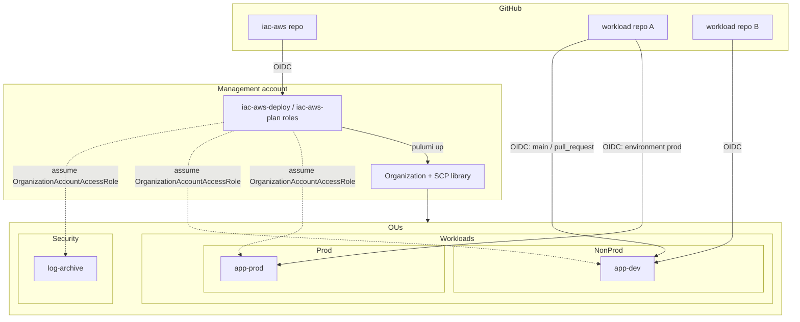

# iac-aws design

Status: draft, 2026-10-10

## Problem

Every new AWS environment starts the same way: create an Organization, lay out OUs, attach guardrail SCPs, vend member accounts, and let one or more GitHub repos deploy into each account through OIDC (no long-lived keys). This repo does that generically, driven by a declarative spec, using Pulumi.

One Pulumi stack = one AWS Organization. Standing up a new org means writing a new stack config, not new code.

## Scope

In v1:

- Organization (all features, SCP policy type enabled)
- OU tree (arbitrary depth, declared as a path like `Workloads/Prod`)
- SCP library + attachments to root, OUs, or accounts
- Member accounts (create or adopt), placed in OUs
- Per-account GitHub OIDC provider and IAM roles trusting specific repos, branches, environments, or PRs
- Self-hosting: the repo deploys itself from GitHub Actions after a one-time local bootstrap

Later (designed for, not built):

- Org CloudTrail + log-archive account, GuardDuty/Security Hub delegated admin
- IAM Identity Center (humans), permission sets, group assignments
- Resource Control Policies, tag policies, budgets
- Centralized root access management (remove root credentials from member accounts)

Out of scope: application infrastructure. Workload repos own their own Pulumi stacks and deploy with the role this repo hands them.

## Architecture



Three trust paths, all short-lived credentials:

1. **iac-aws → management account.** GitHub OIDC into `iac-aws-plan` (PRs, read-only) or `iac-aws-deploy` (main branch, admin). Only this repo can touch the management account.
2. **Management → member accounts.** Pulumi creates one AWS provider per member account that assumes `OrganizationAccountAccessRole` (created by Organizations when it vends the account). The plan role instead assumes a read-only `iac-aws-readonly` role this stack creates in each account, so previews never get admin.
3. **Workload repo → member account.** Each account gets its own `token.actions.githubusercontent.com` provider and the roles declared in the spec. Trust is scoped by the OIDC `sub` claim.

## The spec

The whole org lives in the stack config as one structured value, validated with zod at program start so a typo fails before any AWS call.

```yaml
# Pulumi.acme.yaml
config:
  aws:region: us-east-1
  iac-aws:org:
    accountEmail: aws+{account}@acme.com   # {account} is replaced; plus-addressing gives unique root emails
    selfRepo: acme/iac-aws                 # the repo allowed to deploy this stack
    allowedRegions: [us-east-1, ca-central-1]

    ous:
      - Security
      - Workloads/Prod
      - Workloads/NonProd
      - Sandbox

    scps:
      deny-leave-org:        [root]
      deny-root-user:        [root]
      protect-baseline:      [root]          # CloudTrail, GuardDuty, Config, iac-aws roles
      region-guard:          [Workloads, Sandbox]
      deny-expensive:        [Sandbox]

    accounts:
      log-archive:
        ou: Security
      app-prod:
        ou: Workloads/Prod
        github:
          deploy:
            subjects: ["repo:acme/app:environment:prod"]
            policies: [arn:aws:iam::aws:policy/AdministratorAccess]
      app-dev:
        ou: Workloads/NonProd
        github:
          deploy:
            subjects: ["repo:acme/app:ref:refs/heads/main"]
            policies: [arn:aws:iam::aws:policy/AdministratorAccess]
          plan:
            subjects: ["repo:acme/app:pull_request", "repo:acme/worker:pull_request"]
            policies: [arn:aws:iam::aws:policy/ReadOnlyAccess]
      legacy-billing:
        id: "123456789012"                   # adopt an existing account instead of creating it
        ou: Workloads/Prod
```

Rules the schema enforces:

- `subjects` must name a concrete repo. No `repo:org/*` and no bare `*`; those let any repo in the org (or any repo at all) assume the role.
- Every SCP name must exist in `policies/scp/`. Every OU path in `accounts` and `scps` must be declared in `ous`.
- At most 5 SCPs per target (AWS hard limit, counting the default `FullAWSAccess`).
- Account keys are lowercase kebab-case and become the account name, the `{account}` email token, and the Pulumi resource name. Renaming a key is a replace, so the schema treats keys as permanent.

## Code layout

```
iac-aws/
  Pulumi.yaml
  Pulumi.example.yaml        # the spec above, as a starting point
  src/
    index.ts                 # load spec, wire the pieces in order
    spec.ts                  # zod schema + cross-reference checks
    organization.ts          # Organization, OU tree from paths
    scps.ts                  # load policies/scp/*.json, template, attach
    accounts.ts              # create/adopt accounts, move into OU
    account-provider.ts      # per-account aws.Provider (deploy vs plan role)
    github-oidc.ts           # ComponentResource: OIDC provider + roles in one account
    bootstrap.ts             # mgmt-account OIDC + iac-aws roles, readonly role in members
  policies/scp/
    deny-leave-org.json
    deny-root-user.json
    protect-baseline.json
    region-guard.json        # {{allowedRegions}} templated in; global services exempted
    deny-expensive.json
  test/                      # spec validation + policy rendering unit tests
  .github/workflows/
    preview.yml              # PR: OIDC -> iac-aws-plan -> pulumi preview, comment diff
    up.yml                   # main: OIDC -> iac-aws-deploy -> pulumi up (environment-gated)
```

`GitHubOidcTrust` is the one component with a real interface. Input: an account provider and the account's `github` block. Output: role ARNs. Everything about thumbprints, audiences, condition keys, and session duration stays inside it.

## Key decisions

| Decision | Choice | Why |
|---|---|---|
| Language | TypeScript | Best Pulumi coverage; zod for the spec |
| Spec location | Stack config | One file per org, versioned with the stack, no extra loader |
| State backend | Pulumi Cloud by default, S3 optional | Avoids a bootstrap bucket in an account that does not exist yet |
| Cross-account access | `OrganizationAccountAccessRole` | Exists in every vended account; no extra bootstrap per account |
| Accounts on delete | `protect: true`, `closeOnDeletion` opt-in | Closing an account is slow to undo (90-day window) |
| OIDC thumbprints | Omitted | AWS validates GitHub's OIDC via its trusted CA store; thumbprints are ignored |
| OIDC trust condition | `aud = sts.amazonaws.com` (StringEquals), `sub` (StringLike, no wildcards across repos) | Least privilege per repo/ref/environment |
| Plan vs deploy | Separate roles everywhere | PR previews run with read-only credentials |

## Bootstrap (once per org)

1. Create a fresh AWS account to be the management account. Enable MFA on root, create a temporary admin identity.
2. Create the stack: `pulumi stack init acme`, copy `Pulumi.example.yaml`, edit the spec.
3. If an Organization already exists, `pulumi import` it and any existing OUs/accounts (adopt mode keeps this to IDs in the spec).
4. Run `pulumi up` locally with the temporary admin. This creates the org, OUs, SCPs, accounts, every account's OIDC trust, and the `iac-aws-plan`/`iac-aws-deploy` roles trusting `selfRepo`.
5. Set the role ARNs as repo variables, delete the temporary admin. From now on, all changes go through PRs.

## Gotchas to design around

- **SCPs never apply to the management account.** Keep nothing but org plumbing there.
- **New accounts are not instantly assumable.** `OrganizationAccountAccessRole` can take a minute after `CreateAccount` finishes; the account provider needs a retry/wait.
- **Account names, emails, and `roleName` are effectively create-only.** Set `ignoreChanges` on `roleName`; changing email is a separate root-user flow.
- **Removing an account from the org** requires the account to have its own payment method and root password. Default behaviour on delete should be "error", not "silently try to detach".
- **SCP size limit** is 5,120 characters. Region-guard with a long service exemption list gets close; keep it minified when rendered.
- **Repo renames and transfers.** `sub` uses the repo name, so a deleted-then-recreated repo with the same name inherits trust. Consider GitHub's customizable OIDC subject template with `repository_id`/`repository_owner_id` for high-value roles.

## Open questions

1. Should accounts also get a baseline (default EBS encryption, S3 public access block, IAM password policy, delete default VPCs)? Cheap to add in the same per-account provider loop.
2. One stack per org, or also allow a "multi-org" mode for consultancies managing several clients from one repo? Current answer: one repo, many stacks, which already covers it.
3. Publish `GitHubOidcTrust` as a standalone Pulumi component package, or keep everything in this repo until a second consumer exists?
