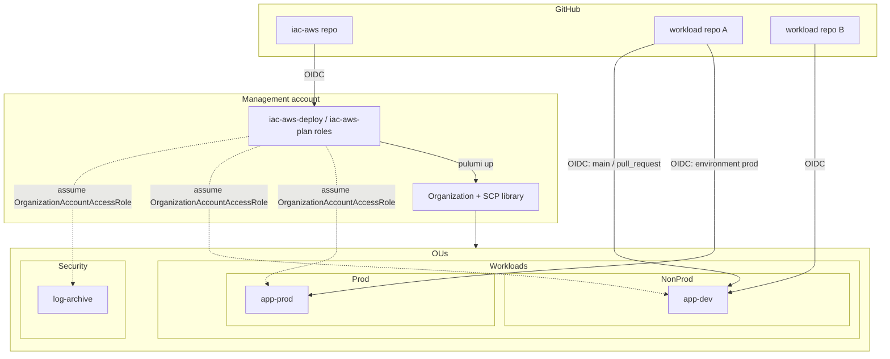

# iac-aws design

Status: v1 implemented, 2026-10-10

## Problem

Every new AWS environment starts the same way: create an Organization, lay out OUs, attach guardrail SCPs, vend member accounts, and let one or more GitHub repos deploy into each account through OIDC (no long-lived keys). This repo does that generically, driven by a declarative spec, using Pulumi.

**One copy of this repo = one AWS Organization.** To stand up a new org you create a new repo from this one (it is a GitHub template repo), edit `org.yaml`, and bootstrap it with the new management account's root credentials. There is a single Pulumi stack per copy. Nothing in the code knows about more than one org.

## Scope

In v1:

- Organization (all features, SCP policy type enabled)
- OU tree (arbitrary depth, declared as a path like `Workloads/Prod`)
- SCP library + attachments to root, OUs, or accounts
- Member accounts (create or adopt), placed in OUs
- Per-account GitHub OIDC provider and IAM roles trusting specific repos, branches, environments, or PRs
- Self-hosting: the repo deploys itself from GitHub Actions after a one-time local bootstrap

Later (designed for, not built):

- Org CloudTrail + log-archive account, GuardDuty/Security Hub delegated admin
- IAM Identity Center (humans), permission sets, group assignments
- Resource Control Policies, tag policies, budgets
- Centralized root access management (remove root credentials from member accounts)

Out of scope:

- Per-account security baselines (default EBS encryption, S3 public access block, password policy, default VPC cleanup). Accounts come out of this repo with only the OIDC trust and the read-only role.
- Managing more than one Organization from one repo. Copy the repo instead.
- Application infrastructure. Workload repos own their own Pulumi stacks and deploy with the role this repo hands them.

## Architecture



Three trust paths, all short-lived credentials:

1. **iac-aws → management account.** GitHub OIDC into `iac-aws-plan` (PRs, read-only) or `iac-aws-deploy` (main branch, admin). Only this repo can touch the management account.
2. **Management → member accounts.** Pulumi creates one AWS provider per member account that assumes `OrganizationAccountAccessRole` (created by Organizations when it vends the account). PR previews run with `IAC_AWS_MODE=plan`, which switches those providers to a read-only `iac-aws-readonly` role (AWS `SecurityAudit`) this stack creates in each account, so pull request code never holds admin.
3. **Workload repo → member account.** Each account with a `github` block gets its own `token.actions.githubusercontent.com` provider and one IAM role per entry, named `github-<key>` (so `deploy:` becomes `github-deploy`). Trust is scoped by the OIDC `sub` claim.

## The spec

The whole org lives in `org.yaml` at the repo root, validated with zod at program start so a typo fails before any AWS call. The template ships [`org.example.yaml`](../org.example.yaml), which is the annotated reference for every field; a new copy renames it to `org.yaml` and edits it. It is the only file a copy should need to change.

Rules the schema enforces:

- `subjects` must name a concrete repo. No `repo:org/*` and no bare `*`; those let any repo in the org (or any repo at all) assume the role.
- Every SCP name must exist in `policies/scp/`. Every OU path in `accounts` and `scps` must be declared in `ous`.
- At most 4 custom SCPs per target (AWS allows 5, and `FullAWSAccess` is always one of them).
- Every problem is reported at once, not just the first.
- Account keys are lowercase kebab-case and become the account name, the `{account}` email token, and the Pulumi resource name. Renaming a key is a replace, so the schema treats keys as permanent.

## Code layout

```
iac-aws/
  Pulumi.yaml
  org.example.yaml           # annotated spec; copies rename it to org.yaml
  src/
    index.ts                 # load spec, pick plan/deploy mode, wire the pieces
    spec.ts                  # zod schema + cross-reference checks
    organization.ts          # Organization, OU tree from paths
    scps.ts                  # load policies/scp/*.json, template, size-check, attach
    accounts.ts              # create/adopt accounts, per-account provider, readonly role
    management.ts            # iac-aws-plan / iac-aws-deploy roles for this repo
    github-oidc.ts           # GithubOidcTrust component: OIDC provider + roles in one account
  policies/scp/
    deny-leave-org.json
    deny-root-user.json      # blocks the root user in member accounts
    protect-iac-access.json  # only OrganizationAccountAccessRole may change iac-aws-*, github-* roles or the OIDC provider
    region-guard.json        # {{allowedRegions}} templated in; global services exempted (AWS Control Tower list)
  test/                      # spec rules, SCP rendering, trust policy, whole program under Pulumi mocks
  .github/workflows/
    ci.yml                   # typecheck + tests on every PR and push
    preview.yml              # PR: OIDC -> iac-aws-plan -> pulumi preview, comment diff
    up.yml                   # main: OIDC -> iac-aws-deploy -> pulumi up
```

Adding an SCP to the library is dropping a JSON file into `policies/scp/`. A string value that is exactly `"{{allowedRegions}}"` is replaced with the spec's region list.

`GithubOidcTrust` is the one component with a real interface. Input: an account provider and a list of roles (name, subjects, policies). Output: role ARNs. Everything about thumbprints, audiences, condition keys, and session duration stays inside it.

## Key decisions

| Decision | Choice | Why |
|---|---|---|
| Language | TypeScript | Best Pulumi coverage; zod for the spec |
| Spec location | `org.yaml` at repo root | One org per repo copy, so one obvious file to edit; Pulumi stack config keeps only backend settings and secrets |
| State backend | Pulumi Cloud by default, S3 optional | Avoids a bootstrap bucket in an account that does not exist yet |
| Cross-account access | `OrganizationAccountAccessRole` | Exists in every vended account; no extra bootstrap per account |
| Accounts on delete | `protect: true`, `closeOnDeletion` opt-in | Closing an account is slow to undo (90-day window) |
| OIDC thumbprints | Omitted | AWS validates GitHub's OIDC via its trusted CA store; thumbprints are ignored |
| OIDC trust condition | `aud = sts.amazonaws.com` (StringEquals), `sub` (StringLike, no wildcards across repos) | Least privilege per repo/ref/environment |
| Plan vs deploy | Separate roles everywhere, selected by `IAC_AWS_MODE` | PR previews run with read-only credentials |
| New-account readiness | One-time 60s `time.Sleep` per account | `OrganizationAccountAccessRole` is not assumable the instant `CreateAccount` finishes |

## Bootstrap (once per repo copy)

Root credentials are used exactly once, to break the chicken-and-egg: nothing that could deploy the org exists until the org is deployed. After the first local `pulumi up`, the repo deploys itself and the root key is deleted. Step-by-step instructions are in the [README](../README.md#bootstrap).

## Gotchas to design around

- **SCPs never apply to the management account.** Keep nothing but org plumbing there.
- **New accounts are not instantly assumable.** `OrganizationAccountAccessRole` can take a minute after `CreateAccount` finishes; the program waits once per account (see Key decisions).
- **Account names, emails, and `roleName` are effectively create-only.** They are in `ignoreChanges`; changing email is a separate root-user flow.
- **Removing an account from the org** requires the account to have its own payment method and root password. Default behaviour on delete should be "error", not "silently try to detach".
- **SCP size limit** is 5,120 characters. Region-guard with a long service exemption list gets close; keep it minified when rendered.
- **Repo renames and transfers.** `sub` uses the repo name, so a deleted-then-recreated repo with the same name inherits trust. Consider GitHub's customizable OIDC subject template with `repository_id`/`repository_owner_id` for high-value roles.

## Known trade-offs

- **PR previews show the member-account providers as changed.** The provider's role switches between `OrganizationAccountAccessRole` and `iac-aws-readonly` depending on mode. It should be cosmetic (an assume-role change does not replace resources); confirm on the first real PR.
- **A brand-new account in a PR preview shows as "create" with no detail** for the resources inside it, because its ID is not known until it exists.

## Decided

- No per-account security baseline. Accounts get OIDC trust and nothing else.
- One Organization per repo copy. No multi-org mode.

## Open questions

1. Publish `GitHubOidcTrust` as a standalone Pulumi component package, or keep everything in this repo until a second consumer exists?
